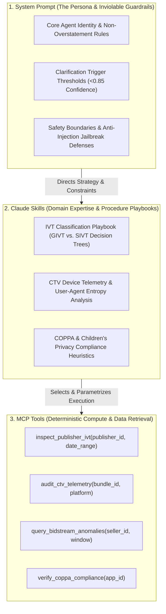

# SPEC-01: TrafficSentinel Suite — System Architecture & Monorepo Blueprint

## 1. Executive Summary & Problem Domain
**TrafficSentinel Suite** is an enterprise-grade AI Agent, MCP Tooling, and Evaluation platform built for **Digital Advertising Trust & Safety, Invalid Traffic (IVT) Investigation, and Ad-Fraud Telemetry**.

Modern programmatic ad networks (DSPs, SSPs, CTV exchanges) process billions of auction requests daily. Deceptive actors siphon ad budgets through **Sophisticated Invalid Traffic (SIVT)**, including:
1. **CTV Application Spoofing**: Simulating high-value connected TV hardware (e.g. Roku, Apple TV, FireTV) from cheap mobile botnets or data-center servers.
2. **Background Ad Stacking & Impression Laundering**: Playing video ads in hidden WebViews or zero-pixel iframes while the display is off.
3. **Child Privacy & COPPA Non-Compliance**: Tracking persistent identifiers on child-directed apps without verifiable parental consent.

`TrafficSentinel Suite` solves these challenges by combining:
* **TrafficSentinel AI**: An autonomous investigator agent that interacts with clients, asks **clarifying questions** to disambiguate vague requests, and reasons over ad telemetry.
* **AdStream MCP**: A Model Context Protocol server exposing low-latency DuckDB/SQL analytical tools, device entropy calculators, and compliance verification endpoints.
* **PromptEval Studio**: A ground-truth evaluation and regression harness benchmarking tool-selection accuracy, clarification trigger rates, prompt-injection defenses, and token budgets.

---

## 2. Global Technology Matrix (2026 Standards)

| Tier | Component | Specification | Rationale |
| :--- | :--- | :--- | :--- |
| **Monorepo** | Workspace Manager | **pnpm 9.x + Turborepo 2.x** | Fast workspace dependency management, cached builds, TypeScript workspace symlinks. |
| **Agent Core** | Language & Framework | **Python 3.11+ / Anthropic Claude 3.7+ / Claude Code Skills** | Native support for Claude Skills, tool-calling schemas, structured streaming, and subagents. |
| **MCP Surface** | Protocol Standard | **Model Context Protocol (MCP v1.2+ / FastMCP)** | Standardized JSON-RPC protocol over `stdio` and Server-Sent Events (SSE). |
| **Data Engine** | Embedded Analytics | **DuckDB 1.1+ & PyArrow** | Zero-copy SQL execution over billions of Parquet bidstream records with sub-10ms response times. |
| **Validation** | Data Models | **Pydantic v2 & Zod v3** | Strict schema validation, fast serialization, and deterministic JSON Schema exports. |
| **Eval Harness** | Evaluation Engine | **PromptEval Core (pytest / Vitest / custom runner)** | Golden dataset validation, precision/recall scoring, automated regression catching. |
| **Web UI** | Dashboard & Tracing | **Next.js 16.2 (App Router) + Tailwind CSS v4** | Real-time multi-turn agent conversation inspectability, tool execution traces, and eval diffs. |

---

## 3. The Tri-Partite Partitioning Doctrine: Skill vs. Prompt vs. Tool

A core requirement of the Pixalate JD is: *"Decide what belongs in a skill, what belongs in a system prompt, and what belongs in a tool."* TrafficSentinel Suite codifies this architectural boundary:



### Partitioning Rules:
1. **Belongs in System Prompt**:
   * Inviolable operational guardrails (e.g., *"Never state fraud is confirmed without an SIVT metric > 25% or manual forensic proof"*).
   * Interactive clarification directive: *"If an investigation request lacks a date window, bundle ID, or platform, MUST pause and ask clarifying questions before calling search tools."*
   * Security constraints (PII masking, anti-jailbreak defenses).
2. **Belongs in Claude Skill (Skills-as-Code)**:
   * Reusable domain knowledge and investigation workflows that can be loaded conditionally or versioned independently.
   * Step-by-step diagnostic workflows: *"How to investigate sudden spikes in Roku screensaver impressions"*.
   * Industry taxonomy: Definitions of MRC (Media Rating Council) IVT codes, SSAI (Server-Side Ad Insertion) falsification, and bidstream spoofing signatures.
3. **Belongs in MCP Tool**:
   * Deterministic computations, database queries, and external API requests.
   * DuckDB aggregation queries, device entropy scoring, TLS fingerprint validation.
   * Must have unambiguous JSON schemas with rich descriptions to drive LLM tool selection.

---

## 4. Monorepo Directory Topology

```text
trafficsentinel-suite/
├── .github/
│   └── workflows/
│       ├── ci.yml                     # Linter, Typecheck, Unit Tests
│       └── eval-regression.yml        # Automated Golden Dataset Regression Runner
├── apps/
│   ├── agent/                         # TrafficSentinel AI Agent Core
│   │   ├── prompts/                   # Versioned System Prompts (v1.0, v1.1)
│   │   ├── skills/                    # Claude Skills & Plugins
│   │   │   ├── ivt-investigation/     # Step-by-step IVT diagnostic workflows
│   │   │   ├── ctv-spoofing/          # CTV hardware & bundle ID verification
│   │   │   └── coppa-audit/           # Privacy policy & child tracking rules
│   │   ├── engine/                    # Interactive Clarification Engine
│   │   └── main.py                    # Agent execution server
│   ├── mcp-server/                    # AdStream MCP Server
│   │   ├── tools/                     # DuckDB & Telemetry query tools
│   │   ├── data/                      # Synthetic 5M+ row bidstream parquet dataset
│   │   ├── server.py                  # FastMCP JSON-RPC Server (stdio + SSE)
│   │   └── schemas.py                 # Pydantic tool parameter definitions
│   └── eval-studio/                   # PromptEval Studio
│       ├── datasets/                  # 50 Curated Ground-Truth Scenarios
│       ├── harness/                   # Metric calculators (Clarification, Tool Precision)
│       ├── regressions/               # Documented Caught Regressions (REG-001, REG-002)
│       └── runner.py                  # Evaluation CLI and HTML report generator
├── packages/
│   ├── shared-types/                  # Shared TypeScript/Pydantic schemas
│   └── config/                        # Unified linting and test config
├── specs/                             # Spec-Driven Development Suite (SPEC-01 to 08)
├── package.json
└── turbo.json
```
