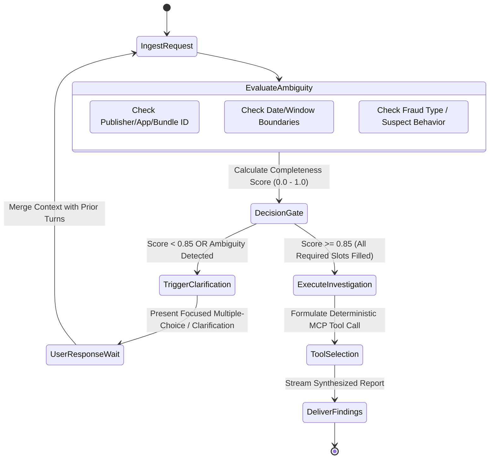

# SPEC-02: Interactive Clarification Engine & Disambiguation Protocol

## 1. Executive Summary
A critical failure mode of enterprise LLM agents is **premature execution**: an agent receives an incomplete or underspecified prompt (e.g., *"Why is traffic down?"* or *"Audit this publisher for fraud"*), hallucinates assumptions, and executes expensive, irrelevant database queries.

The Pixalate JD explicitly demands:
> *"Design agents that ask clarifying questions and gather requirements interactively, rather than answering one-shot from incomplete information... when they stop and ask the user a clarifying question instead of guessing."*

`SPEC-02` defines the **Disambiguation State Machine** and **Ambiguity Scoring Gate** that powers `TrafficSentinel AI`.

---

## 2. The Clarification State Machine

---

## 3. Ambiguity Scoring Gate (`AmbiguityGate`)

Before any MCP tool is invoked, the incoming query passes through the `AmbiguityGate` heuristic. It assesses **Required Slots** against the target investigative domain:

### Required Slots by Investigation Domain:
| Domain | Mandatory Required Slots | Optional / Defaultable Slots |
| :--- | :--- | :--- |
| **Publisher IVT Audit** | `publisher_id` OR `domain`, `timeframe` (e.g. Last 7d, Q3) | `traffic_type` (default: All), `device_category` |
| **CTV App Spoofing** | `bundle_id` OR `app_name`, `target_platform` (Roku, FireTV, AppleTV) | `baseline_benchmark` (default: Category Average) |
| **Bidstream Anomaly** | `seller_id` OR `exchange_id`, `anomaly_signal` (e.g., CTR spike, IP cluster) | `sample_size` (default: 100k events) |
| **COPPA Compliance** | `app_id` / `store_url` | `target_age_group` (default: Under 13) |

### Completeness Score Formula:
$$\text{Completeness} = \frac{\sum_{i=1}^{M} w_i \cdot \mathbb{I}(\text{slot}_i \text{ is present})}{\sum_{i=1}^{M} w_i}$$

* If $\text{Completeness} < 0.85$, the agent **MUST NOT** call an MCP tool.
* Instead, it generates a structured clarification payload asking the user for the missing parameters.

---

## 4. Multi-Turn Interactive Clarification Protocols

### Example Scenario: Underspecified Customer Request

#### ❌ The Naive / Prototypes Failure Mode (One-Shot Guessing):
> **User**: *"Check if StreamMaster app is committing ad fraud."*  
> **Naive Agent**: Runs `inspect_app_telemetry("streammaster.apk")` assuming Android, runs queries across all dates, returns a massive generic wall of text with false positives.

#### ✅ TrafficSentinel AI Protocol (Interactive Clarification):
> **User**: *"Check if StreamMaster app is committing ad fraud."*  
> **TrafficSentinel AI**:  
> *"I found multiple applications matching 'StreamMaster' across Connected TV (CTV) and Mobile platforms. To run an accurate forensic audit, I need to clarify a few details:*  
> *1. **Platform**: Are you investigating the **Roku Channel** (`com.roku.streammaster`) or the **FireTV app** (`com.amazon.streammaster`)?*  
> *2. **Suspected Behavior**: Are you seeing a spike in **background video impressions**, **unusual click-through rates (CTR)**, or **device ID spoofing**?*  
> *3. **Timeframe**: What date range or campaign flight should I analyze (e.g., past 7 days, September 2026)?"*

---

## 5. Maximum Clarification Bound & Circuit Breaker

To prevent the agent from annoying users with infinite back-and-forth loops:
1. **Max Turn Limit**: Maximum of **2 clarification turns** per investigation task.
2. **Graceful Default Fallback**: If after 2 turns the user provides partial info (e.g. only provides platform), the agent falls back to conservative defaults and explicitly logs:
   > *"Proceeding with Roku Channel (`com.roku.streammaster`) over the default 7-day lookback window based on your partial inputs."*
3. **Audit Log Recording**: Every clarification triggered is logged to `agent_audit_traces` with:
   * `initial_prompt`
   * `missing_slots`
   * `clarification_questions`
   * `user_resolution`
