# SPEC-07: Phased Implementation Plan & Execution Milestones

## 1. Executive Summary
`SPEC-07` specifies the step-by-step implementation sequence for **TrafficSentinel Suite**. Execution is structured into 5 cohesive phases, prioritizing testability and specification compliance at every stage.

---

## 2. Phased Execution Roadmap

```mermaid
gantt
    title TrafficSentinel Suite Implementation Sequence
    dateFormat  X
    axisFormat %s
    section Phase 1: Scaffolding
    Monorepo & Shared Types      :active, p1, 0, 2
    section Phase 2: AdStream MCP
    DuckDB Parquet Lake & FastMCP:p2, 2, 4
    section Phase 3: Agent Core
    Clarification Engine & Skills:p3, 4, 7
    section Phase 4: Eval Studio
    50 Golden Datasets & Evals   :p4, 7, 9
    section Phase 5: Integration
    Regression CI Gate & Docs    :p5, 9, 10
```

### Phase 1: Workspace Scaffolding & Foundations
* Initialize `package.json`, `turbo.json`, and Python virtual environment (`uv` / `venv`).
* Define TypeScript shared types and Pydantic v2 schemas in `packages/shared-types`.
* Configure root linting (`ruff`, `eslint`, `vitest`, `pytest`).

### Phase 2: AdStream MCP Server
* Generate synthetic Parquet dataset (500k rows of realistic ad telemetry, GIVT/SIVT rates, CTV app stores).
* Implement FastMCP server with the 4 core tools:
  * `inspect_publisher_ivt`
  * `audit_ctv_telemetry`
  * `query_bidstream_anomalies`
  * `verify_coppa_compliance`
* Add unit tests for tool schemas, token limits (<800 tokens), and SQL aggregation performance.

### Phase 3: TrafficSentinel AI Agent & Clarification Engine
* Author versioned System Prompts (`prompts/system_prompt_v1.0.txt`).
* Implement Claude Skills directory (`skills/ivt-investigation/SKILL.md`, `skills/ctv-spoofing/SKILL.md`).
* Build `AmbiguityGate` and the interactive clarification state machine.
* Wire FastMCP client integration for automated tool execution.

### Phase 4: PromptEval Studio & Golden Benchmark
* Author the 50 Curated Golden Scenarios in JSON/YAML format.
* Implement the evaluation runner calculating CTR, TSA, CCR, and Latency.
* Recreate and verify the historical regression `REG-2026-IVT-04` to prove CI regression catching capability.

### Phase 5: Verification, CI Integration & Documentation
* Set up GitHub Actions workflow (`.github/workflows/eval-regression.yml`).
* Author production-grade `README.md` complete with architecture diagrams, CV bullet points, and usage guides.
* Validate all tests passing end-to-end.
